<div align="center">


# Nodyx

### *"The network is the people."*

**The self-hosted community platform you actually own.**<br/>
Forum, chat, voice, whiteboard and your own homepage. One install, on your server, for one community.

[](https://github.com/Pokled/nodyx/releases/latest)
[](https://www.gnu.org/licenses/agpl-3.0)
[](https://github.com/Pokled/Nodyx/actions/workflows/ci.yml)
[](https://nodyx.org/translate)
[](https://nodyx.org/discover)

<!-- Les deux derniers badges ne sont pas figés : ils interrogent nodyx.org à
     chaque affichage, ils disent la vérité du jour. -->

[](https://nodyx.org)
[](https://nodyx.dev)
[](https://start.nodyx.org)
[](docs/fr/README.md)
[](docs/es/README.md)

<br/>

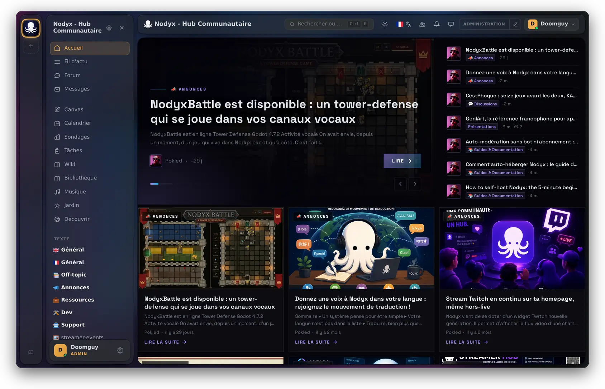

<sub>nodyx.org, the project's own community, running the same Nodyx you can install. The screenshots show the French interface; Nodyx speaks nine languages, English included.</sub>

</div>

---

## What it is

Nodyx gives a community one home that it owns: a forum that search engines can read, real-time chat, voice channels with screen sharing, a collaborative whiteboard, events, polls, and a public homepage you build by drag and drop. Everything runs on one server that you control, from a cheap VPS to a Raspberry Pi behind your home router.

```bash
curl -fsSL https://nodyx.org/install.sh | bash
```

No Docker, no cloud account, no domain required. The installer sets everything up and hands you an admin account a few minutes later.

> **Before you scroll.** Nodyx isn't here to fight Discord, and it isn't the only open alternative. Matrix, Discourse, Stoat, Fluxer, Mattermost, Rocket.Chat, Haven and others are good projects, and we list them on a page we wrote ourselves: **[Why Nodyx, and the alternatives we respect](https://nodyx.dev/why-nodyx)**. The fight isn't between us. It's between locked silos and communities that own themselves.

---

## A tour

### Talk, the way your community actually talks

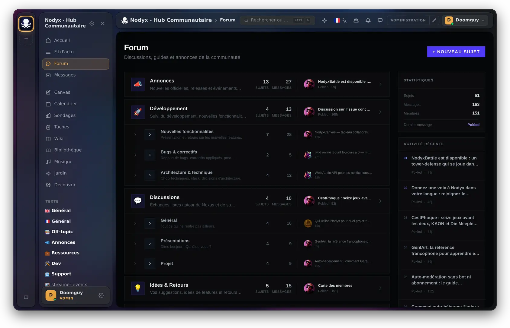

A real forum, with categories, sub-forums and the latest message of each, so you see at a glance where the life is. Every thread has a clean public URL, structured data and a place in the sitemap: what your community writes can be found again, by search engines and by the next newcomer. Next to it, real-time chat with replies, reactions and pins, end-to-end encrypted private messages, and voice channels with screen sharing.

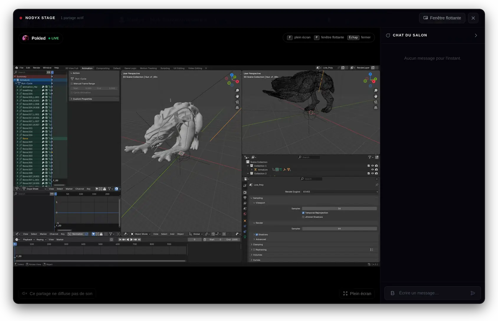

Screen sharing opens on the **Nodyx Stage**, in full screen or as a floating window, and anyone who joins the room while you share sees it straight away.

### Make things together

<table>
  <tr>
    <td width="50%">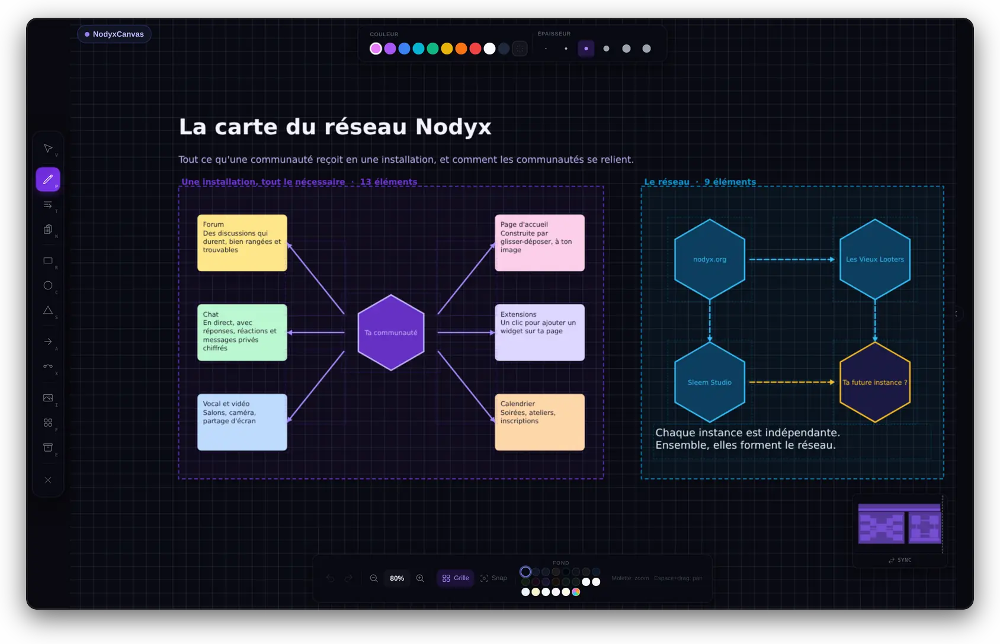</td>
    <td width="50%">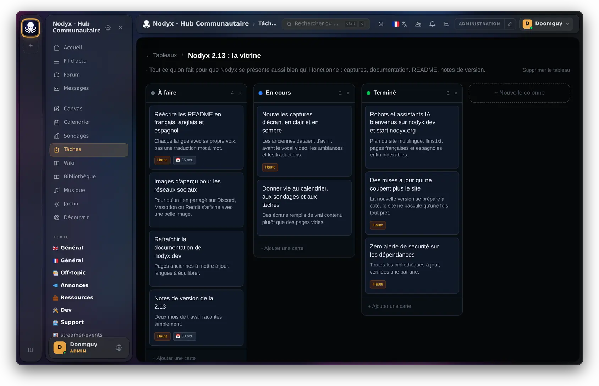</td>
  </tr>
  <tr>
    <td><b>Whiteboard.</b> A shared board: frames, notes, shapes, connectors, images. Everyone draws at the same time, everything is saved.</td>
    <td><b>Task boards.</b> Plan a release, a tournament or a meetup in columns, with priorities and due dates.</td>
  </tr>
  <tr>
    <td width="50%">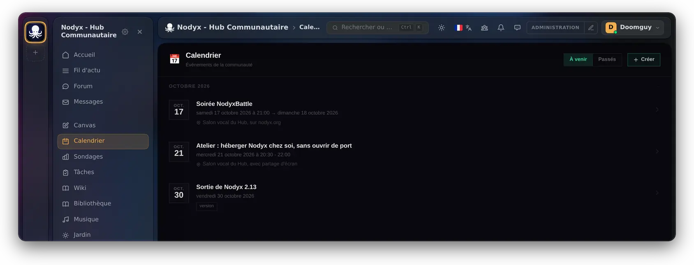</td>
    <td width="50%">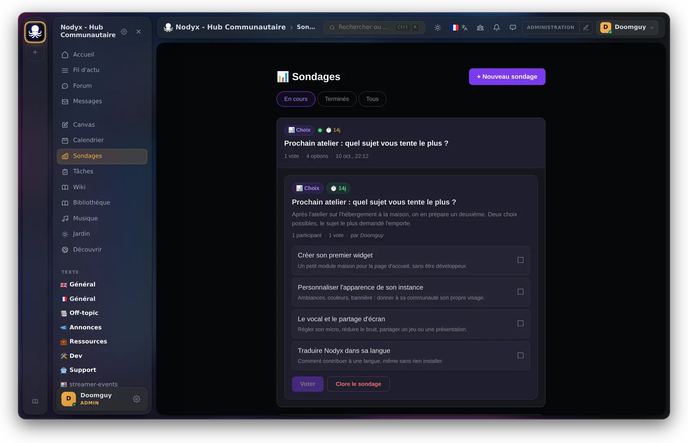</td>
  </tr>
  <tr>
    <td><b>Events.</b> Game nights, workshops, releases, with a place, a map and sign-ups.</td>
    <td><b>Polls.</b> Choice, ranking or scheduling, with results live.</td>
  </tr>
</table>

### Your front door, your way

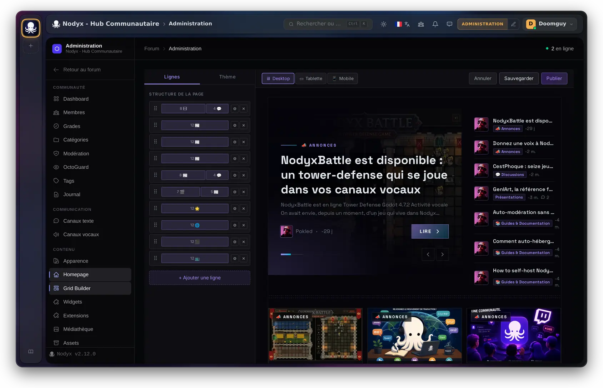

The homepage is yours to compose. Rows and columns on a 12-unit grid, native widgets, a draft that only you see until you publish, and a preview on desktop, tablet and mobile. Need something that doesn't exist yet? The **Extension SDK** lets anyone build a widget or a game in plain JavaScript, and [extensions.nodyx.org](https://extensions.nodyx.org) installs it in one click. Extensions run sandboxed: they never see real accounts, their storage is walled off, their network access goes through a guarded proxy.

<table>
  <tr>
    <td width="50%">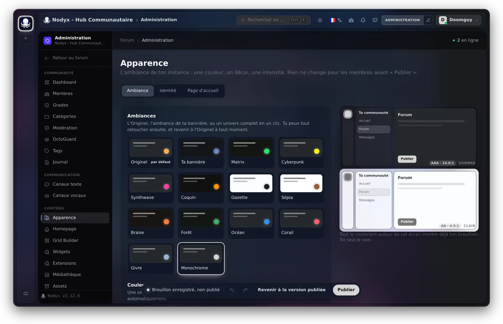</td>
    <td width="50%">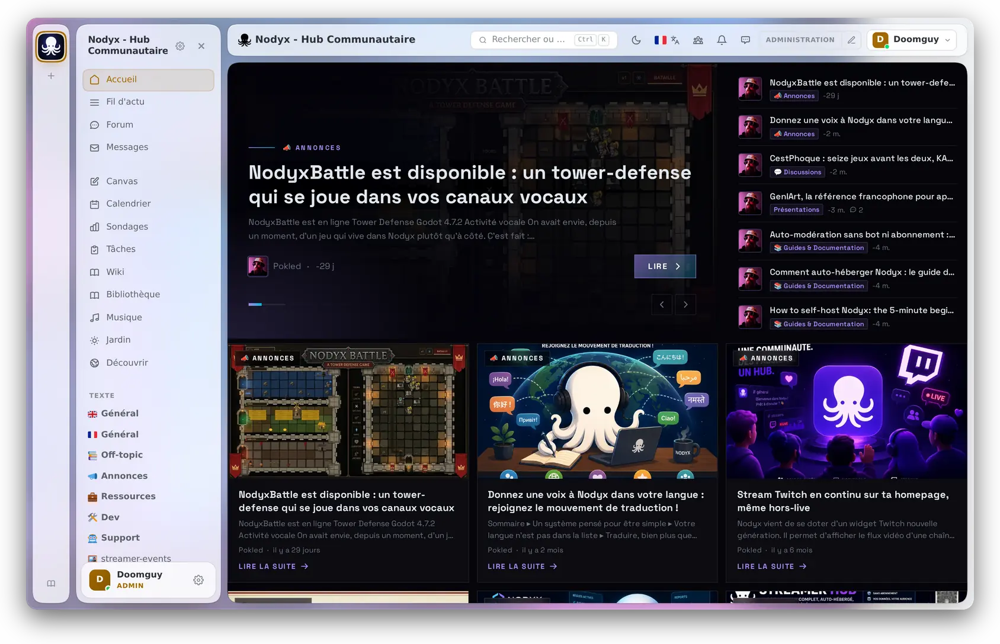</td>
  </tr>
  <tr>
    <td><b>Ambiances.</b> Fourteen ready-made looks, or your own colors. Contrast is checked for you, and members see nothing until you press Publish.</td>
    <td><b>Light or dark.</b> Each member picks, the community's identity stays.</td>
  </tr>
</table>

### Made by people, for people

<table>
  <tr>
    <td width="50%">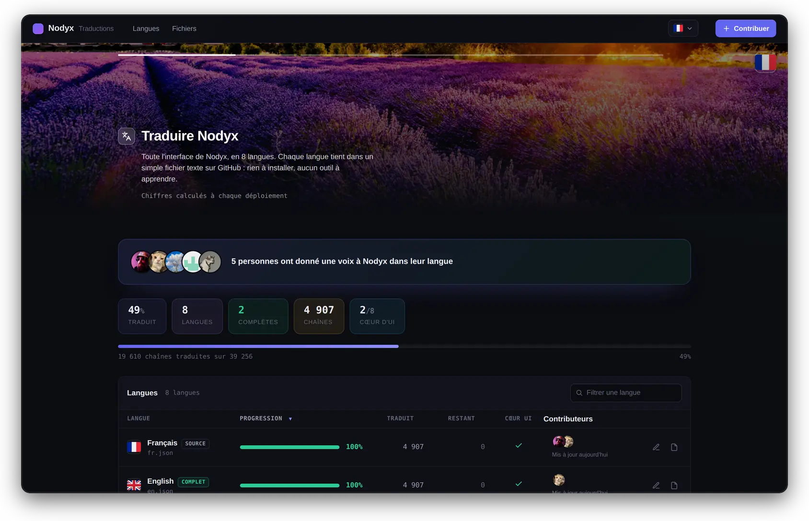</td>
    <td width="50%">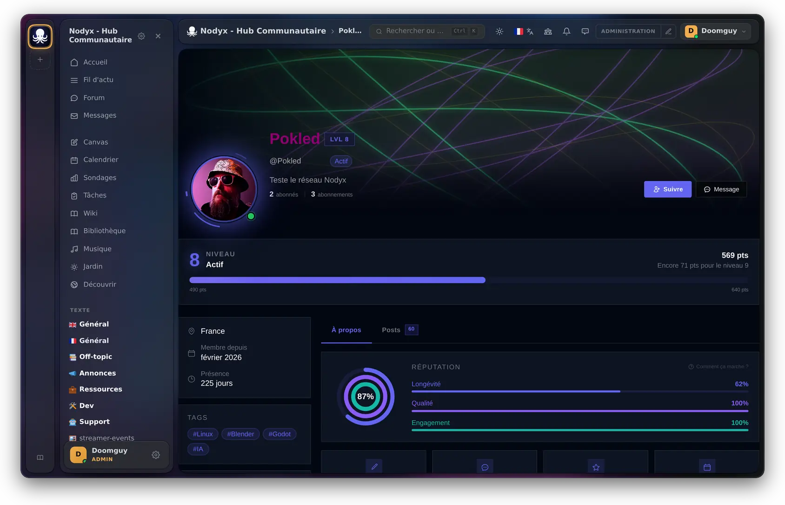</td>
  </tr>
  <tr>
    <td><b>Nine languages, translated by the community.</b> Each language is one plain text file: no account, no tool, no platform in between. <a href="https://nodyx.org/translate">See where each one stands, live.</a></td>
    <td><b>Profiles that tell a story.</b> Levels, reputation, tags, presence: a member is more than a username.</td>
  </tr>
</table>

### And the rest of the house

- **A home server, no open port.** The Nodyx relay, written in Rust, gives your instance a public address (`yourclub.nodyx.org`) with only outbound connections. Website, chat and small-group voice work from behind a home router. Large voice rooms go through an SFU that still needs a publicly reachable server; making it work behind a router too is the next big piece of work.
- **Voice that scales.** Small rooms talk peer to peer. When a room grows or someone shares their screen, it switches to an SFU on your own server: one upload per speaker, whatever the size of the audience.
- **Games inside the voice channel.** Activities dock right into a voice room, so you play together without leaving the call.
- **A network of communities.** Each instance can appear in a shared directory and be searched from the others, without any central account.
- **Streamer Hub.** Soundboard with a viewer queue, mobile stream deck, seven OBS overlays, Twitch chat integration. [Guide](docs/en/STREAMER-HUB.md)
- **Library, music, wiki, garden of ideas.** Frames, badges and banners shared by members, a public music showcase, a wiki, and a place where ideas grow with the community's votes.
- **Moderation tools.** Roles and grades, a moderation log, IP and account bans, and OctoGuard, an optional auto-moderator (word, link and flood filters, welcome messages, custom commands), every switch off by default.

---

## Where each project shines

The community-tools landscape isn't a battle. Each project optimizes for different things, and the right pick depends on what you are building. Here is how we would put it to a friend:

| Project | What it does best | Where it fits |
|---|---|---|
| **Discord** | Real-time voice and chat for closed groups, mobile first, a huge bot ecosystem | Your community is private and informal |
| **Matrix** ([Element](https://github.com/element-hq/element-web)) | A federated protocol with bridges to almost everything | Interoperability is non-negotiable |
| **[Discourse](https://github.com/discourse/discourse)** | Indexed, searchable forums and knowledge bases | Long-form discussion is your core |
| **[Mattermost](https://github.com/mattermost/mattermost)** / **[Rocket.Chat](https://github.com/RocketChat/Rocket.Chat)** | Enterprise compliance, a Slack replacement at scale | You have a procurement team |
| **[Haven](https://github.com/ancsemi/Haven)** | Privacy-first chat, native clients, no telemetry | Every byte must stay on your own machine |
| **[Stoat](https://github.com/stoatchat/self-hosted)** / **[Fluxer](https://github.com/fluxerapp/fluxer)** | A Discord-shaped interface, easy migration | Your members already know Discord |
| **Lemmy** | Federated, Reddit-style threaded forums | You want a fediverse-native presence |
| **Nodyx** | Forum, chat, voice, whiteboard and homepage in one install, with a relay for home servers | You want to own a multi-format community on your own hardware |

If you only need one or two of these formats, another tool above may suit you better. [Our honest take, alternatives included.](https://nodyx.dev/why-nodyx)

---

## Security

Self-hosting means keeping the community safe is your job. Nodyx is built to make that job smaller.

| Surface | How it's handled |
|---|---|
| Passwords | Argon2id with OWASP parameters, old bcrypt hashes migrated transparently |
| Private messages | End-to-end encrypted (ECDH P-256 and AES-256-GCM). Keys never leave the browser, the server only stores ciphertext |
| Two-factor | TOTP apps, or Nodyx Signet, a passwordless ECDSA P-256 app |
| Every input | Validated against a schema, parameterized SQL only |
| Every response | CSP, HSTS, frame protection, sanitized HTML |
| Rate limiting | Keyed on the real visitor address, behind Cloudflare, Caddy or a tunnel alike |
| Backups | Proven every night by an automatic restore, not just a copied file |

Found a vulnerability? **Please don't open a public issue.** Write to `security@nodyx.org` or use [GitHub's private advisories](https://github.com/Pokled/nodyx/security/advisories/new). We answer within 48 hours, assess within 7 days, and credit you in the release notes unless you'd rather stay anonymous. [Full security policy](.github/SECURITY.md)

---

## Install

You need a machine running **Ubuntu 22.04 / 24.04** or **Debian 11 / 12 / 13** (64-bit, ARM64 included, so a Raspberry Pi 4 or 5 works), and `curl`.

```bash
curl -fsSL https://nodyx.org/install.sh | bash
```

The installer asks how your instance should be reached:

| Mode | You need | You get |
|---|---|---|
| **Nodyx Relay** (recommended) | Nothing, outbound connections only | `yourclub.nodyx.org`, even behind a home router |
| **Your own domain** | A domain and ports 80/443 open | HTTPS with Let's Encrypt, full control |
| **sslip.io** | Ports 80/443 open, no domain | A free automatic address |

Already behind a tunnel? `install_tunnel.sh` covers **Cloudflare Tunnel**, **Pangolin** and home-made tunnels (frp, rathole, your own reverse proxy).

It installs Node.js, PostgreSQL, Redis, Caddy, PM2 and the Rust voice relay, generates every secret, runs the database migrations and creates your admin account. Unattended installs work too (`--yes`, `--network=relay`, `--admin-password-file`).

Once installed:

```bash
sudo nodyx-update    # update to the latest version, database backed up first
sudo nodyx-doctor    # check that every service is healthy
sudo nodyx-recover   # get back into a lost admin account
```

[Complete installation guide](docs/en/INSTALL.md) · [Tunnel installation](docs/en/INSTALL-TUNNEL.md)

---

## Under the hood

| Layer | Technology |
|---|---|
| API | TypeScript, Fastify 5, Socket.IO (`nodyx-core/`) |
| Web app | SvelteKit 5, Tailwind 4, TipTap editor (`nodyx-frontend/`) |
| Data | PostgreSQL 16 with full-text search, Redis 7 for sessions and presence, 125 migrations applied automatically at startup |
| Voice | WebRTC peer to peer for small rooms, an SFU on your server for large ones and screen sharing |
| Network | `nodyx-relay` (home servers without open ports) and `nodyx-turn` (STUN/TURN), both in Rust (`nodyx-p2p/`) |
| Sign-in without password | Nodyx Signet, an ECDSA P-256 app (`nodyx-authenticator/`) |
| Process and proxy | PM2 under a dedicated `nodyx` user, Caddy with automatic HTTPS |

<details>
<summary>Repository layout</summary>

```
nodyx/
├── nodyx-core/          API, Socket.IO, database migrations
├── nodyx-frontend/      SvelteKit web app
├── nodyx-p2p/           Rust: relay and TURN server
├── nodyx-authenticator/ Nodyx Signet, passwordless sign-in
├── nodyx-docs/          nodyx.dev, the documentation site
├── nodyx-landing/       start.nodyx.org
├── docs/                Markdown documentation (EN, FR, ES)
├── install.sh           installer (relay, own domain, sslip.io)
└── install_tunnel.sh    installer behind Cloudflare Tunnel, Pangolin or your own tunnel
```

</details>

<details>
<summary>How instances find each other</summary>

Each instance can register in a shared directory and periodically share its public card: name, address, number of members. The `/discover` page of any instance searches the public threads and events of the others. There is no global account and no dependency on ActivityPub: the protocol is deliberately small, and an instance that leaves the directory keeps working exactly the same.

</details>

---

## Where it's going

Nodyx was born on February 18, 2026 and has shipped twelve versions since: the forum, chat and voice foundation, end-to-end encrypted messages, the Homepage Builder and its extension marketplace, games in voice channels, the Streamer Hub, verified backups, the Rust SFU for voice and screen sharing. The next big step is making large voice rooms work from a home server too, so that no Nodyx admin ever has to open a port.

[Changelog](CHANGELOG.md) · [Roadmap](docs/en/ROADMAP.md) · [Manifesto](docs/en/MANIFESTO.md)

---

## Contribute

Nodyx belongs to its community. Read [CONTRIBUTING.md](docs/en/CONTRIBUTING.md), browse the [issues](https://github.com/Pokled/Nodyx/issues) or start a [discussion](https://github.com/Pokled/Nodyx/discussions). Documentation and ideas (`docs/`, `docs/ideas/`) are open to everyone without asking first; changes to the core start with an issue.

**Translate Nodyx.** French, English and Simplified Chinese are complete, Brazilian Portuguese is nearly there, and five more languages are under way. Pick yours on [nodyx.org/translate](https://nodyx.org/translate), fill in the missing lines of one JSON file, open a pull request. The CI checks every placeholder, so a translation can't break the app.

### Nodyx Stars

Every outside contribution earns a star, and every star goes on [our Hall of Fame](CONTRIBUTORS.md) with its story. Open source without recognition is just free labor, and that's not how we do things.

<table>
  <tr>
    <td align="center" width="140">
      <a href="https://github.com/Pranto2003"></a><br/>
      <b>Pranto Goswamee</b><br/><sub>🌟 First contributor</sub>
    </td>
    <td align="center" width="140">
      <a href="https://github.com/waazaa-fr"></a><br/>
      <b>waazaa-fr</b><br/><sub>🌟🌟 Installer bugs</sub>
    </td>
    <td align="center" width="140">
      <a href="https://github.com/naranco66"></a><br/>
      <b>naranco66</b><br/><sub>🌟🌟🌟 Spanish (es-ES)</sub>
    </td>
    <td align="center" width="140">
      <a href="https://github.com/forke24x7"></a><br/>
      <b>forke24x7</b><br/><sub>🌟🌟🌟🌟🌟 German (de)</sub>
    </td>
    <td align="center" width="140">
      <a href="https://github.com/lukasMega"></a><br/>
      <b>Lukáš Melega</b><br/><sub>🌟🌟 Docs search</sub>
    </td>
  </tr>
</table>

[Every story, every contributor](CONTRIBUTORS.md)

---

## Support

Nodyx is built by one developer, with no investor and no strings attached. If it's useful to you, a star helps others find it, and [Ko-fi](https://ko-fi.com/Pokled) helps pay for the servers.

<a href="https://ko-fi.com/Pokled"></a>

---

## License

**AGPL-3.0.** If you run a modified Nodyx for others, even over a network, your changes stay open. And if Nodyx ever betrays its principles, this license lets anyone fork it and carry on in the spirit of the [Manifesto](docs/en/MANIFESTO.md).

<div align="center">
  <br/>
  <p><em>Born February 18, 2026.</em></p>
  <p><strong>"Fork us if we betray you."</strong></p>
</div>
